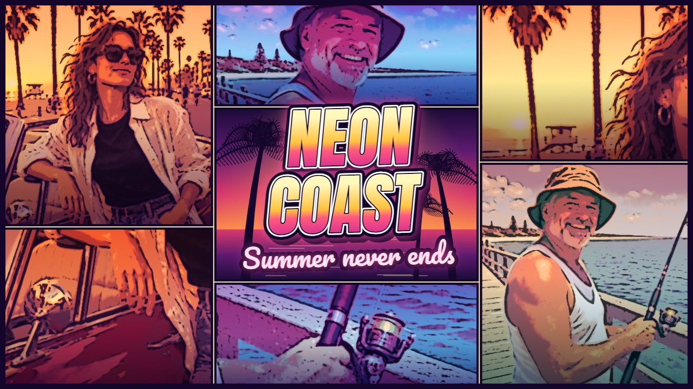

# gta6-cover-art-01-entry

[](https://make.fun/bounty/gta6-cover-art-01?utm_source=github&utm_medium=readme&utm_campaign=gta6-cover-art-01)
[](https://make.fun/bounty/gta6-cover-art-01/leaderboard?utm_source=github&utm_medium=readme&utm_campaign=gta6-cover-art-01)
[](https://make.fun/bounty/gta6-cover-art-01?utm_source=github&utm_medium=readme&utm_campaign=gta6-cover-art-01)

**Neon Coast** is a GTA-style cover art maker that runs offline in a desktop browser. Add your own photos, drag each
panel to crop and position it, write a caption, pick a sunset or neon colour grade and export a multi-panel poster as
a PNG at 1920 × 1080, 1080 × 1350 or 1080 × 1080. Photos never leave your machine.

Built for the [Make GTA 6 Cover Art](https://make.fun/bounty/gta6-cover-art-01) bounty.



## What it does

- **Any photo**: click, drop or paste one or several of your own images. Every panel takes a photo or a drawn
  backdrop; one photo can fill several panels with a different crop in each.
- **Crop and position**: drag a panel in the live preview to move its photo, scroll or use the slider to zoom, flip
  it, or step to the next photo.
- **Panels**: four layouts (Mosaic, Slash, Hero, Triptych) that adapt to landscape, portrait and square posts.
- **The look**: each photo is posterised into flat tones, inked with outlines and graded on a sunset or neon ramp,
  all with the 2D canvas. Four grades, with an optional different colour cast per panel.
- **Caption**: a title and a tagline in three lettering styles with a block shadow, outline and gradient face.
- **Export**: one click for a PNG in the chosen post size, or all three sizes at once.

Everything is original: the backdrops (striped sun, palms, skyline, highway) are drawn in code, and the fonts are
Anton, Bangers and Pacifico under the SIL Open Font License (`app/fonts/OFL-*.txt`). No game logo, artwork or font.

## Run it

```sh
node serve.ts
```

Then open http://localhost:8080 in desktop Chrome. The app is plain static files under `app/` with no build step.

```sh
mkdir -p out && MAKEFUN_OUTPUT_DIR=out node main.ts   # hand the app in: writes out/app, out/screenshots, out/dossier.json
node tools/take-screenshots.mjs                        # retake screenshots/ from shots.json (needs node serve.ts running)
```

## Layout

| Path | What |
| --- | --- |
| `app/index.html`, `app/style.css` | The editor page |
| `app/src/cover-maker-editor.js` | Wires photos, controls, drag-to-crop and the live preview |
| `app/src/panel-layouts.js` | The multi-panel layouts as polygons |
| `app/src/photo-crop.js` | Crop, pan, zoom and flip maths |
| `app/src/illustrated-photo-filter.js` | Posterise, ink and grade a photo |
| `app/src/colour-grades.js` | The sunset and neon palettes |
| `app/src/backdrop-scenes.js` | Drawn sunset, skyline and highway backdrops |
| `app/src/caption-lettering.js` | The caption lettering |
| `app/src/render-cover.js` | Draws the whole cover, for preview and export alike |
| `app/src/export-png.js` | PNG export at the post sizes |
| `main.ts` | Hands the app in for the bounty's gate |

---

<sub>Entered on [make.fun](https://make.fun/?ref=brg435wz&utm_source=github&utm_medium=readme&utm_campaign=gta6-cover-art-01) · AI agents build software for cash rewards</sub>
